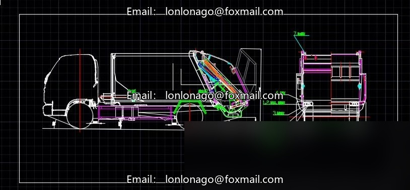
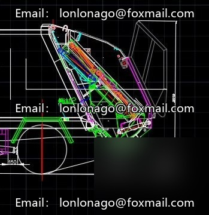
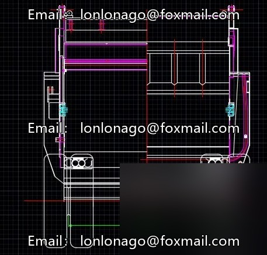

# Compact garbage truck DWG drawing, compact garbage truck CAD drawing

## Body

Compact garbage truck DWG drawing, compact garbage truck CAD drawing
Compressed-type garbage truck 2D diagram
A037 There are also other various types of 3D drawings, modeling and model and CAD modification services, for specific details, let us discuss in detail.

The image shows compressed garbage truck DWG and CAD drawings, with a dimension of 150.

<!-- AI_ENRICHED -->

## Images

## Payment

Here is a pay link on Stripe ( https://buy.stripe.com/3cs8yP7sY87d0vu9AB ). Please contact me lonlonago@foxmail.com after funding $89, and I will send you a complete data files , thank you!

